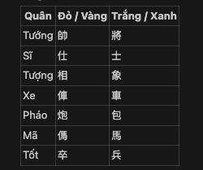

# Tứ Sắc Terminal

Game bài **Tứ Sắc** chơi trong terminal: 1 người + 3 bot, luật cấu hình được, có chế độ học luật
(hint / why / undo), save/load JSON và replay theo seed. Cài đặt theo
`Tu_Sac_Terminal_VSCode_Design_Spec.docx`.

> Profile mặc định `training_basic` là **luật luyện tập** minh bạch, không phải "luật chuẩn Nha Trang".

## Cài đặt & chạy

```bash
python3.11 -m venv .venv
source .venv/bin/activate          # Windows: .venv\Scripts\activate
python -m pip install -e ".[dev]"

python -m tusac                    # chơi (bạn ngồi D, nhà cái A, seed ngẫu nhiên)
python -m tusac --seed 42 --seat D --dealer D --bots easy,medium,medium
python -m tusac --rules family_nhatrang     # hoặc --rules duong/dan/luat.yaml
python -m tusac --demo --seed 7             # 4 bot tự chơi
python -m tusac --sim 1000 --seed 1         # mô phỏng 1.000 ván, in thống kê
python -m tusac --replay saves/ten.json     # phát lại một ván đã lưu
python -m tusac --ascii                     # bỏ chữ Hán / khung Unicode

pytest -q
```

## Cách chơi

1. **Xếp bài** – sau khi chia, ván chưa bắt đầu. Bạn xếp bài tùy ý rồi gõ `ready`:
   - `sort color` (theo màu), `sort rank` (theo loại)
   - **Khu vực xếp bộ**: `sort meld` tự xếp bộ tối ưu; `bo 3 7 9` tự gom quân thành bộ;
     `tach 2` / `tach all` trả bộ về "Rác / chờ"; `check` kiểm tra bộ nào hợp lệ (✓/✗),
     còn bao nhiêu rác và cách xếp đã tối ưu chưa.
   - `move 5 1` chuyển quân số 5 lên vị trí 1, `swap 3 8` đổi chỗ hai quân (chế độ tự do).
     Cách xếp được giữ suốt ván; quân mới vào nằm cuối tay. Có thể xếp lại bất cứ lúc nào.
   - Quân bài mặc định chỉ hiện chữ Hán tô màu; `names on` để hiện thêm tên tiếng Việt.
2. **Tới lượt đánh**: `discard <số>`.
3. **Có quân vừa ra / vừa bốc mà bạn ăn được**: game liệt kê lựa chọn `a) b) ...` →
   `claim a`, hoặc tự chọn quân trên tay `claim 3 7`; không ăn thì `pass`.
4. **Không ai ăn quân trước**: `draw` để bốc nọc.
5. Mọi lúc: `hint` (gợi ý + giải thích), `why` (vì sao luật cho/không cho), `history 10`,
   `rules`, `undo`, `save ten`, `load ten`, `new --seed 42`, `help`, `quit`.

Phím tắt: `x`=discard, `c`=claim, `p`=pass, `d`=draw, `h`=hand, `t`=table, `u`=undo, `r`=ready, `q`=quit.

## Luật luyện tập (`training_basic`)

- 112 quân = 4 màu (Đỏ, Xanh, Vàng, Trắng) × 7 loại (Tướng, Sĩ, Tượng, Xe, Pháo, Mã, Tốt) × 4.
  Chia 21 cho nhà cái, 20 cho ba nhà còn lại, nọc 31.
- Phe: Đôi / Khạp (3 giống) / Quàn (4 giống) cùng màu cùng loại; Tướng-Sĩ-Tượng hoặc
  Xe-Pháo-Mã cùng màu; 3 hoặc 4 Tốt khác màu. Tướng đứng một mình không tính là rác.
- **Tới** khi mọi quân trên tay đều thành phe.
- Nhà kế tiếp được ăn quân vừa đánh để ghép bất kỳ bộ nào; nhà khác chỉ được ăn thành
  Khạp/Quàn hoặc để tới. Không ai ăn → nhà kế tiếp bốc nọc; quân bốc nếu không dùng thì để lại
  cho các nhà khác.
- Ưu tiên: Tới > Quàn > Khạp > bộ khác; cùng hạng thì nhà gần người đánh hơn.
- Hết nọc mà chưa ai tới → hòa. Phạt/đền: tắt.

Các tùy chọn trong `config/rules.training.yaml` (bắt buộc ăn khạp, khui quàn tự động, cấm tách
khạp, không tăng rác...) có thể bật/tắt. `config/rules.family_nhatrang.yaml` là mẫu để điền luật
nhà theo checklist mục 13 của đặc tả. `reference_vinagames` cố ý chưa bật cho tới khi đối chiếu
từng điều khoản.

## Cấu trúc

```
src/tusac/
  models.py        Card, Meld, Action, RuleResult, GameState
  deck.py          bộ 112 quân, xáo theo seed, chia bài
  melds.py         nhận diện bộ, phân tích rác tối ưu
  rules/           RuleConfig + TableRuleset (mọi quyết định có reason_code)
  engine.py        máy trạng thái, kiểm bất biến 112 quân sau mỗi action
  bots.py          bot Easy / Medium (chỉ thấy bài mình + thông tin công khai)
  trainer.py       hint / why
  arrange.py       xếp bài: theo màu / loại / phe / tự do
  persistence.py   save/load JSON (dựng lại bằng replay + so khớp snapshot)
  render.py, cli.py  giao diện Rich và vòng lặp lệnh
tests/             deck, melds, engine, invariants (1.000 ván), persistence, cli
```


